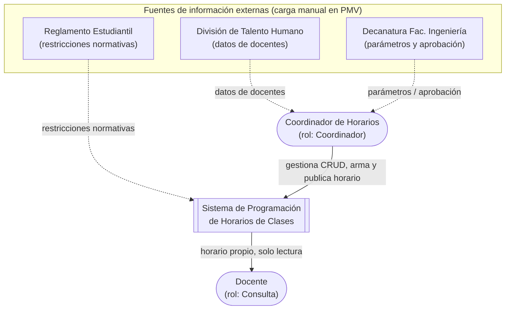

# Diagrama de Contexto — Sistema de Programación de Horarios de Clases

## Propósito

Ubica el sistema dentro del sistema de información completo (personas, infraestructura TI, datos, procesos organizacionales y software), identificando actores y fuentes de información externas con las que interactúa, de conformidad con el alcance acotado del PMV.

## Actores

| Actor | Rol en el sistema | Interacción |
|---|---|---|
| Coordinador de Horarios | `Coordinador` | Gestiona docentes, asignaturas, grupos y parámetros; arma, valida y publica el horario. |
| Docente | `Consulta` | Consulta y exporta su propio horario. No crea, modifica ni elimina información. |

## Fuentes de información externas

Ninguna tiene integración automática (API/archivo) en el PMV. Los datos se cargan manualmente por el Coordinador a través del CRUD del sistema.

| Entidad externa | Información que aporta |
|---|---|
| División de Gestión del Talento Humano | Datos de docentes: vinculación, tiempo (completo/¾/medio/¼), escalafón. |
| Decanatura, Facultad de Ingeniería | Aprobación de oferta académica y restricciones de presupuesto. |
| Reglamento Estudiantil | Restricciones normativas de carga académica, mapeadas a `ConfiguracionHorarios`. |

## Diagrama

## Notas de alcance (PMV)

- Línea punteada: flujo de información manual, sin integración automatizada.
- Línea sólida: interacción directa con el sistema (UI / API).
- Fuera de este diagrama: aulas y espacios físicos, inscripción de estudiantes y reasignación automática de grupos (fuera de alcance del PMV, ver `README.md`).
